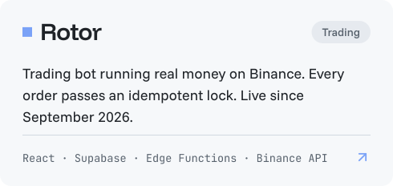
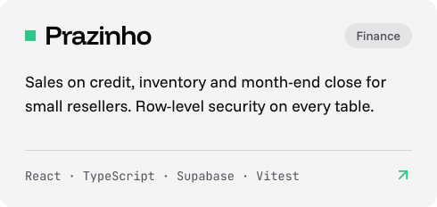
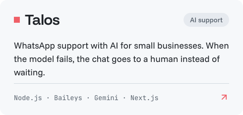
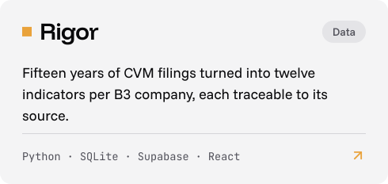
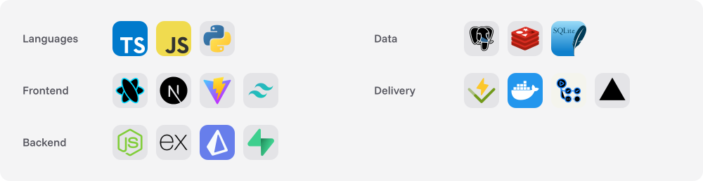
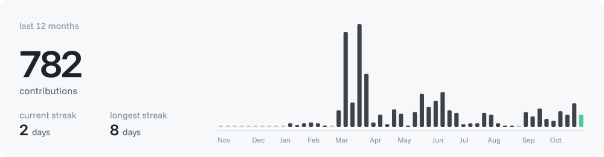

<b>English</b> · <a href="https://github.com/bk-marcosr/bk-marcosr/blob/main/README.pt-BR.md">Português</a>

<a href="https://bk-marcosr.github.io/portfolio-bk/"><picture><source media="(prefers-color-scheme: dark)" srcset="assets/en/dark/banner.svg"><source media="(prefers-color-scheme: light)" srcset="assets/en/light/banner.svg"></picture></a>

### About

- 🚗 Data and automation at **RR Chevrolet**: Python and Rocketbot bots that turn CRM events into KPI dashboards
- 🏢 Founder of **BKode**, building products and systems for small businesses
- 🎓 Information Systems at **UFRA** · Administrative & Finance Director at **UTIC**, UFRA's IT junior enterprise
- ⚙️ I like software that fails safely: idempotent orders, row-level security on every table, a human when the AI can't answer
- 📫 Fastest way to reach me is [e-mail](mailto:marcosgabriel20061216@gmail.com)

### Selected work

<a href="https://bk-marcosr.github.io/portfolio-bk/projetos/rotor/"><picture><source media="(prefers-color-scheme: dark)" srcset="assets/en/dark/card-rotor.svg"><source media="(prefers-color-scheme: light)" srcset="assets/en/light/card-rotor.svg"></picture></a>&nbsp;<a href="https://bk-marcosr.github.io/portfolio-bk/projetos/prazinho/"><picture><source media="(prefers-color-scheme: dark)" srcset="assets/en/dark/card-prazinho.svg"><source media="(prefers-color-scheme: light)" srcset="assets/en/light/card-prazinho.svg"></picture></a>
<a href="https://bk-marcosr.github.io/portfolio-bk/projetos/talos/"><picture><source media="(prefers-color-scheme: dark)" srcset="assets/en/dark/card-talos.svg"><source media="(prefers-color-scheme: light)" srcset="assets/en/light/card-talos.svg"></picture></a>&nbsp;<a href="https://bk-marcosr.github.io/portfolio-bk/projetos/rigor/"><picture><source media="(prefers-color-scheme: dark)" srcset="assets/en/dark/card-rigor.svg"><source media="(prefers-color-scheme: light)" srcset="assets/en/light/card-rigor.svg"></picture></a>

Most of these repositories are private. Case studies with live simulations are on my <a href="https://bk-marcosr.github.io/portfolio-bk/">portfolio</a>.

### Stack

<a href="https://bk-marcosr.github.io/portfolio-bk/"><picture><source media="(prefers-color-scheme: dark)" srcset="assets/en/dark/stack.svg"><source media="(prefers-color-scheme: light)" srcset="assets/en/light/stack.svg"></picture></a>

### Activity

<a href="https://github.com/bk-marcosr"><picture><source media="(prefers-color-scheme: dark)" srcset="assets/en/dark/activity.svg"><source media="(prefers-color-scheme: light)" srcset="assets/en/light/activity.svg"></picture></a>

### Contact

<a href="https://www.linkedin.com/in/marcos-gabriel-rodrigues-ba%C3%ADa-0181022a5/"><picture><source media="(prefers-color-scheme: dark)" srcset="assets/en/dark/button-linkedin.svg"><source media="(prefers-color-scheme: light)" srcset="assets/en/light/button-linkedin.svg"></picture></a>&nbsp;<a href="mailto:marcosgabriel20061216@gmail.com"><picture><source media="(prefers-color-scheme: dark)" srcset="assets/en/dark/button-email.svg"><source media="(prefers-color-scheme: light)" srcset="assets/en/light/button-email.svg"></picture></a>&nbsp;<a href="https://bk-marcosr.github.io/portfolio-bk/"><picture><source media="(prefers-color-scheme: dark)" srcset="assets/en/dark/button-portfolio.svg"><source media="(prefers-color-scheme: light)" srcset="assets/en/light/button-portfolio.svg"></picture></a>

