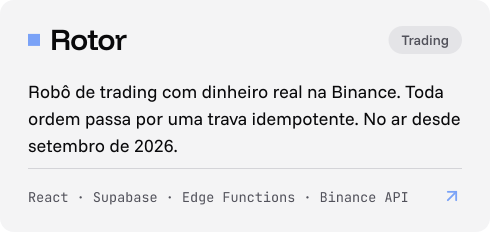
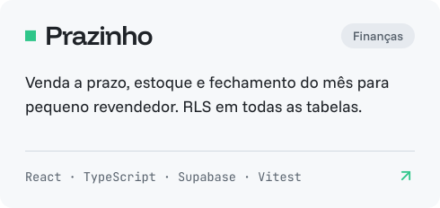
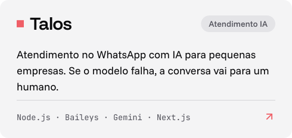
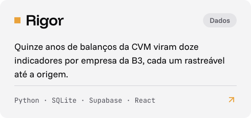
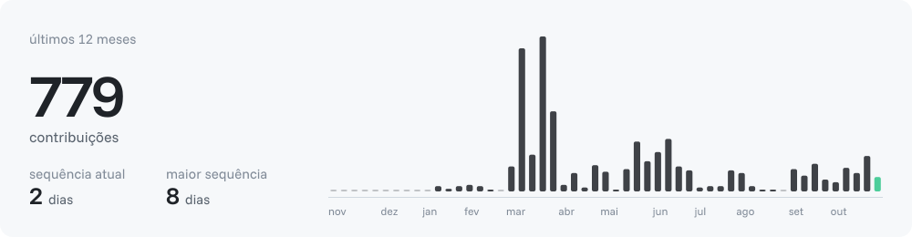

<a href="https://github.com/bk-marcosr">English</a> · <b>Português</b>

<a href="https://bk-marcosr.github.io/portfolio-bk/"><picture><source media="(prefers-color-scheme: dark)" srcset="assets/pt/dark/banner.svg"><source media="(prefers-color-scheme: light)" srcset="assets/pt/light/banner.svg"></picture></a>

### Sobre

- 🚗 Dados e automação na **RR Chevrolet**: robôs em Python e Rocketbot que transformam eventos do CRM em dashboards de KPI
- 🏢 Fundador da **BKode**, construindo produtos e sistemas para pequenas empresas
- 🎓 Sistemas de Informação na **UFRA** · Diretor Administrativo-Financeiro da **UTIC**, a empresa júnior de TI da UFRA
- ⚙️ Gosto de software que falha com segurança: ordem idempotente, RLS em toda tabela, um humano quando a IA não sabe responder
- 📫 O jeito mais rápido de falar comigo é por [e-mail](mailto:marcosgabriel20061216@gmail.com)

### Projetos

<a href="https://bk-marcosr.github.io/portfolio-bk/projetos/rotor/"><picture><source media="(prefers-color-scheme: dark)" srcset="assets/pt/dark/card-rotor.svg"><source media="(prefers-color-scheme: light)" srcset="assets/pt/light/card-rotor.svg"></picture></a>&nbsp;<a href="https://bk-marcosr.github.io/portfolio-bk/projetos/prazinho/"><picture><source media="(prefers-color-scheme: dark)" srcset="assets/pt/dark/card-prazinho.svg"><source media="(prefers-color-scheme: light)" srcset="assets/pt/light/card-prazinho.svg"></picture></a>
<a href="https://bk-marcosr.github.io/portfolio-bk/projetos/talos/"><picture><source media="(prefers-color-scheme: dark)" srcset="assets/pt/dark/card-talos.svg"><source media="(prefers-color-scheme: light)" srcset="assets/pt/light/card-talos.svg"></picture></a>&nbsp;<a href="https://bk-marcosr.github.io/portfolio-bk/projetos/rigor/"><picture><source media="(prefers-color-scheme: dark)" srcset="assets/pt/dark/card-rigor.svg"><source media="(prefers-color-scheme: light)" srcset="assets/pt/light/card-rigor.svg"></picture></a>

A maioria desses repositórios é privada. Os estudos de caso, com simulações ao vivo, estão no meu <a href="https://bk-marcosr.github.io/portfolio-bk/">portfólio</a>.

### Stack

<a href="https://bk-marcosr.github.io/portfolio-bk/"><picture><source media="(prefers-color-scheme: dark)" srcset="assets/pt/dark/stack.svg"><source media="(prefers-color-scheme: light)" srcset="assets/pt/light/stack.svg"></picture></a>

### Atividade

<a href="https://github.com/bk-marcosr"><picture><source media="(prefers-color-scheme: dark)" srcset="assets/pt/dark/activity.svg"><source media="(prefers-color-scheme: light)" srcset="assets/pt/light/activity.svg"></picture></a>

### Contato

<a href="https://www.linkedin.com/in/marcos-gabriel-rodrigues-ba%C3%ADa-0181022a5/"><picture><source media="(prefers-color-scheme: dark)" srcset="assets/pt/dark/button-linkedin.svg"><source media="(prefers-color-scheme: light)" srcset="assets/pt/light/button-linkedin.svg"></picture></a>&nbsp;<a href="mailto:marcosgabriel20061216@gmail.com"><picture><source media="(prefers-color-scheme: dark)" srcset="assets/pt/dark/button-email.svg"><source media="(prefers-color-scheme: light)" srcset="assets/pt/light/button-email.svg"></picture></a>&nbsp;<a href="https://bk-marcosr.github.io/portfolio-bk/"><picture><source media="(prefers-color-scheme: dark)" srcset="assets/pt/dark/button-portfolio.svg"><source media="(prefers-color-scheme: light)" srcset="assets/pt/light/button-portfolio.svg"></picture></a>

