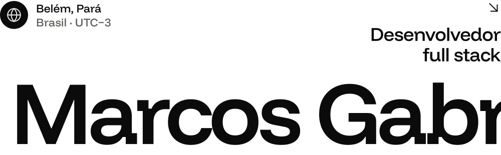
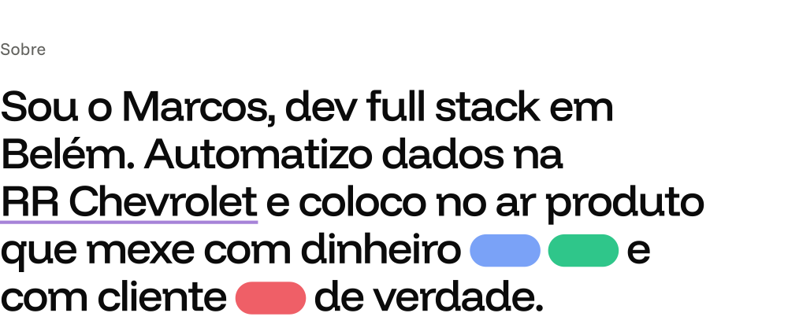
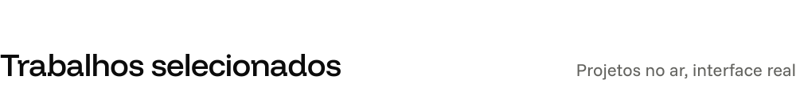
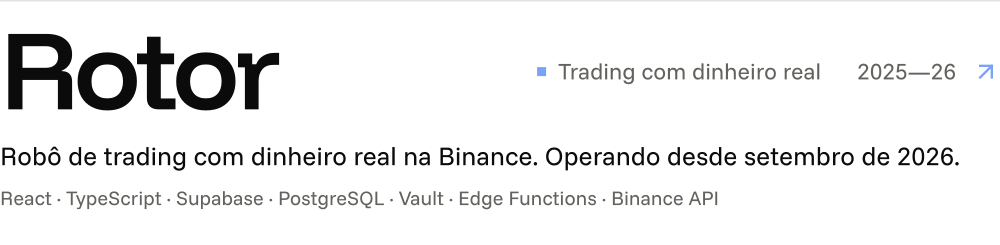
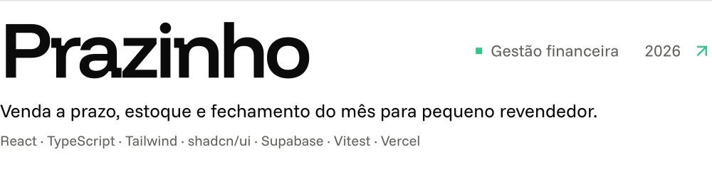
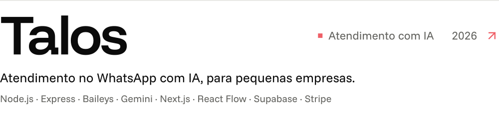
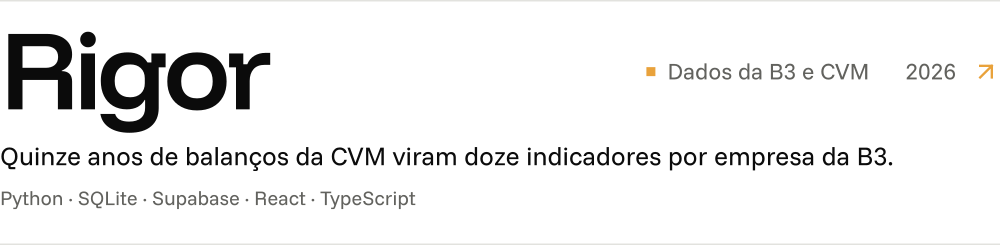
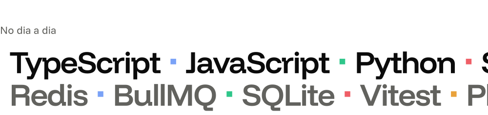
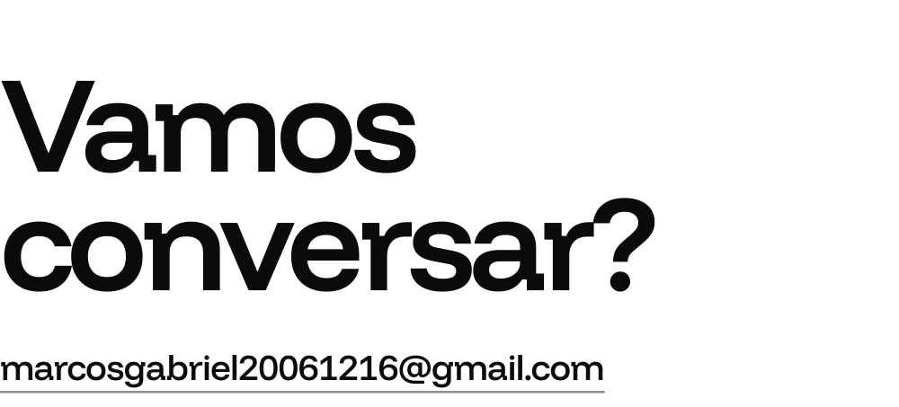

<!-- Generated by tools/build.py from tools/content.py. Edit those files and rebuild; do not edit this one by hand. -->

<a href="https://github.com/bk-marcosr"><picture><source media="(prefers-color-scheme: dark)" srcset="assets/common/dark/lang-en-off.svg"><source media="(prefers-color-scheme: light)" srcset="assets/common/light/lang-en-off.svg"></picture></a>&nbsp;&nbsp;&nbsp;<a href="https://github.com/bk-marcosr/bk-marcosr/blob/main/README.pt-BR.md"><picture><source media="(prefers-color-scheme: dark)" srcset="assets/common/dark/lang-pt-on.svg"><source media="(prefers-color-scheme: light)" srcset="assets/common/light/lang-pt-on.svg"></picture></a>

<a href="https://bk-marcosr.github.io/portfolio-bk/"><picture><source media="(prefers-color-scheme: dark)" srcset="assets/pt/dark/hero.svg"><source media="(prefers-color-scheme: light)" srcset="assets/pt/light/hero.svg"></picture></a>
<a href="https://bk-marcosr.github.io/portfolio-bk/#sobre"><picture><source media="(prefers-color-scheme: dark)" srcset="assets/pt/dark/about.svg"><source media="(prefers-color-scheme: light)" srcset="assets/pt/light/about.svg"></picture></a>
<a href="https://bk-marcosr.github.io/portfolio-bk/#trabalhos"><picture><source media="(prefers-color-scheme: dark)" srcset="assets/pt/dark/work.svg"><source media="(prefers-color-scheme: light)" srcset="assets/pt/light/work.svg"></picture></a>
<a href="https://bk-marcosr.github.io/portfolio-bk/projetos/rotor/"><picture><source media="(prefers-color-scheme: dark)" srcset="assets/pt/dark/work-rotor.svg"><source media="(prefers-color-scheme: light)" srcset="assets/pt/light/work-rotor.svg"></picture></a>
<a href="https://bk-marcosr.github.io/portfolio-bk/projetos/prazinho/"><picture><source media="(prefers-color-scheme: dark)" srcset="assets/pt/dark/work-prazinho.svg"><source media="(prefers-color-scheme: light)" srcset="assets/pt/light/work-prazinho.svg"></picture></a>
<a href="https://bk-marcosr.github.io/portfolio-bk/projetos/talos/"><picture><source media="(prefers-color-scheme: dark)" srcset="assets/pt/dark/work-talos.svg"><source media="(prefers-color-scheme: light)" srcset="assets/pt/light/work-talos.svg"></picture></a>
<a href="https://bk-marcosr.github.io/portfolio-bk/projetos/rigor/"><picture><source media="(prefers-color-scheme: dark)" srcset="assets/pt/dark/work-rigor.svg"><source media="(prefers-color-scheme: light)" srcset="assets/pt/light/work-rigor.svg"></picture></a>
<a href="https://bk-marcosr.github.io/portfolio-bk/"><picture><source media="(prefers-color-scheme: dark)" srcset="assets/pt/dark/also.svg"><source media="(prefers-color-scheme: light)" srcset="assets/pt/light/also.svg"></picture></a>
<a href="https://bk-marcosr.github.io/portfolio-bk/#sobre"><picture><source media="(prefers-color-scheme: dark)" srcset="assets/pt/dark/ledger.svg"><source media="(prefers-color-scheme: light)" srcset="assets/pt/light/ledger.svg"></picture></a>
<a href="https://bk-marcosr.github.io/portfolio-bk/#sobre"><picture><source media="(prefers-color-scheme: dark)" srcset="assets/pt/dark/stack.svg"><source media="(prefers-color-scheme: light)" srcset="assets/pt/light/stack.svg"></picture></a>
<a href="mailto:marcosgabriel20061216@gmail.com"><picture><source media="(prefers-color-scheme: dark)" srcset="assets/pt/dark/contact.svg"><source media="(prefers-color-scheme: light)" srcset="assets/pt/light/contact.svg"></picture></a>

<a href="https://www.linkedin.com/in/marcos-gabriel-rodrigues-ba%C3%ADa-0181022a5/"><picture><source media="(prefers-color-scheme: dark)" srcset="assets/pt/dark/link-linkedin.svg"><source media="(prefers-color-scheme: light)" srcset="assets/pt/light/link-linkedin.svg"></picture></a>&nbsp;&nbsp;&nbsp;&nbsp;<a href="https://bk-marcosr.github.io/portfolio-bk/"><picture><source media="(prefers-color-scheme: dark)" srcset="assets/pt/dark/link-portfolio.svg"><source media="(prefers-color-scheme: light)" srcset="assets/pt/light/link-portfolio.svg"></picture></a>&nbsp;&nbsp;&nbsp;&nbsp;<a href="mailto:marcosgabriel20061216@gmail.com"><picture><source media="(prefers-color-scheme: dark)" srcset="assets/pt/dark/link-email.svg"><source media="(prefers-color-scheme: light)" srcset="assets/pt/light/link-email.svg"></picture></a>

Belém, PA · Cores tiradas dos próprios projetos.

